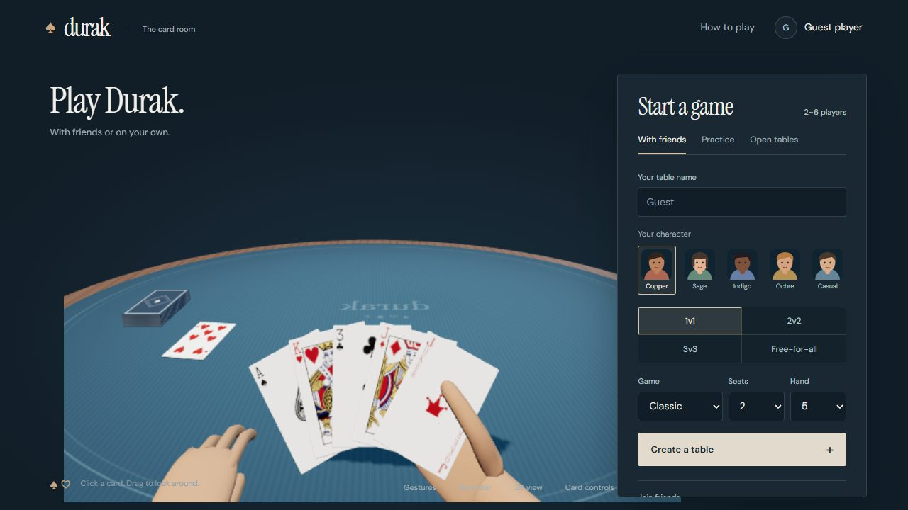
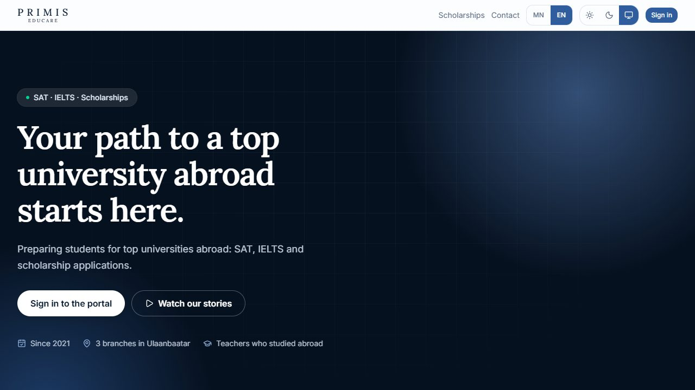
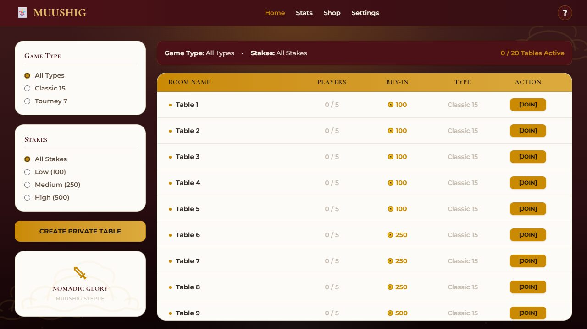

  
  
  

I'm a CS student at **UBC Okanagan** in Kelowna, originally from Mongolia. I like building things people actually use, like card games my friends play over Discord and the portal a tutoring center in Ulaanbaatar runs on.

## Featured work

<table>
<tr>
<td width="55%"></td>
<td width="45%">

### [Durak](https://github.com/turbo-leg/Durak)
Multiplayer Durak card game that runs **inside Discord voice calls**.

- Server-authoritative game state, so no player can see another's hand
- 3D card table in Three.js, with bots and 2–6 players
- 290+ commits · 50+ test files · CI · Fly.io

    

</td>
</tr>
<tr>
<td width="45%">

### Primis · [live](https://primiseducare.com) private
Production IELTS/SAT prep portal for a tutoring center in Mongolia, with **student, teacher, parent and admin** roles.

- Google sign-in for students and phone codes for parents
- Rotating QR codes link a parent to their child, no admin needed
- Attendance, payments, web push, Google Classroom, mobile apps
- 190+ commits · 50+ test files · CI · Sentry

    

</td>
<td width="55%"></td>
</tr>
<tr>
<td width="55%"></td>
<td width="45%">

### Muushig · [play](https://muushig.fly.dev) private
Mongolia's classic trick-taking card game, built as a Discord Activity.

- Fully tested rules engine shared by client and server
- Elo ratings, leaderboard, spectators and private tables
- Bilingual rules book and generative tavern music

   

</td>
</tr>
</table>

## More projects

<table>
<tr>
<td width="50%">

**[Error404](https://github.com/turbo-leg/Error404)** 
Team-built job board with applications, profiles and an admin panel. 
React · Express · MongoDB · Jest

</td>
<td width="50%">

**Mongolia Basketball API** 
REST API for the national league, with scraping and daily cron sync. 
Next.js · Supabase · Vercel Cron

</td>
</tr>
<tr>
<td width="50%">

**Oyuna AI** 
Bilingual Mongolian/English AI chat app. 
Next.js · Supabase

</td>
<td width="50%">

**[Invoice Generator](https://st-my.vercel.app)** 
Invoices with stamp and signature placement, exported to PDF. 
Next.js · jsPDF

</td>
</tr>
</table>

## Tech I use

  

## Activity

  <picture>
    <source media="(prefers-color-scheme: dark)" srcset="https://github-profile-summary-cards.vercel.app/api/cards/stats?username=turbo-leg&theme=github_dark"/>
    
  </picture>
  <picture>
    <source media="(prefers-color-scheme: dark)" srcset="https://streak-stats.demolab.com?user=turbo-leg&theme=github-dark-blue&hide_border=true"/>
    
  </picture>

