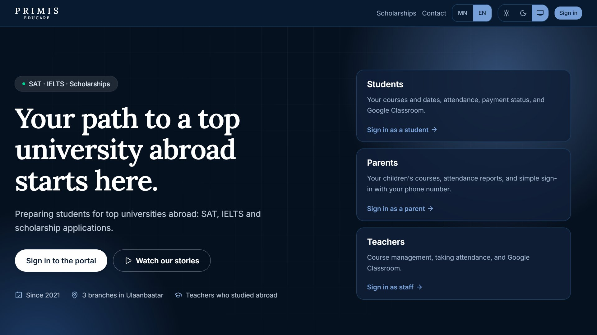
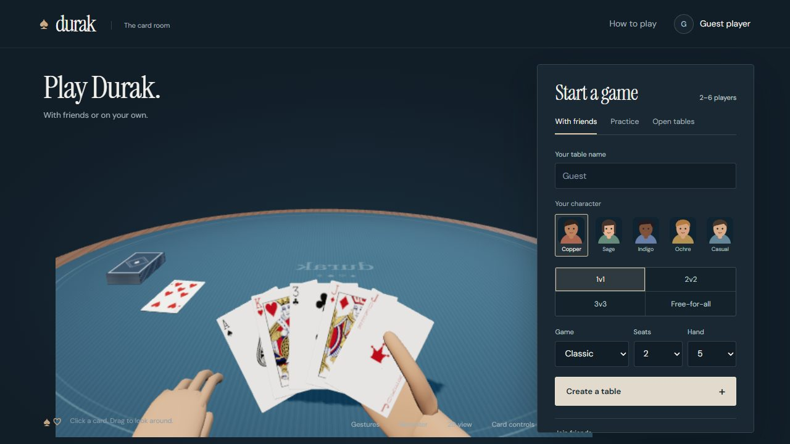
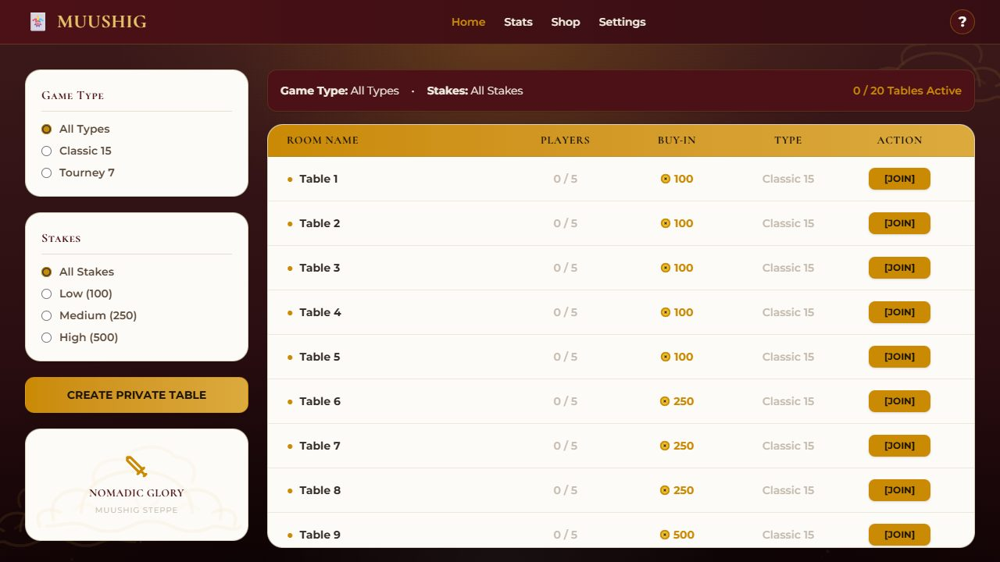

# Turbileg Uurtsaikh

Fourth-year Computer Science student at UBC Okanagan in Kelowna, BC, graduating in 2027. I build web apps for real users and multiplayer games my friends actually play.

Looking for software engineering internships and new-grad roles in Canada.
[turbileg@student.ubc.ca](mailto:turbileg@student.ubc.ca) · [LinkedIn](https://linkedin.com/in/turbileg-uurtsaikh-42ab97237)

## Projects

### Primis EduCare portal
[primiseducare.com](https://primiseducare.com) · [project overview](https://github.com/turbo-leg/primis-portal)

The portal my family's tutoring center in Ulaanbaatar runs on, replacing paper and Excel: courses, attendance, parent accounts, payment reminders and Google Classroom. I built it alone with FastAPI, PostgreSQL and Nuxt. It runs on Railway and Vercel, with Alembic migrations, a cron worker and about 600 tests that run in CI. The code is private because the portal holds children's data. I'm happy to walk through it in an interview.

### Durak
[Play it](https://durak-discord-activity.fly.dev) · [code](https://github.com/turbo-leg/Durak)

The card game Durak, played inside Discord voice calls with 2 to 6 players or bots. The server owns the game state and sends each player only their own hand. TypeScript, Colyseus, React and Three.js, deployed on Fly.io from CI.

### Muushig
[Play it](https://muushig.fly.dev) · [code](https://github.com/turbo-leg/Muushig)

Muushig, a Mongolian trick-taking card game, as a Discord Activity. The rules engine is shared by client and server, and players get Elo ratings and a leaderboard.

## Also

- [Error404](https://github.com/turbo-leg/Error404): a job board our team built in COSC 360 (React, Express, MongoDB).

Languages I use most: Python, TypeScript, SQL. I also write C and CUDA for coursework.
